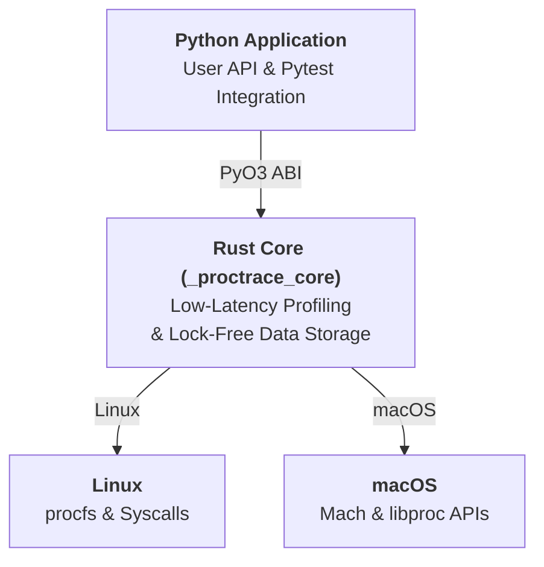

# proctrace: Technical Guide & Developer Manual

`proctrace` is a high-performance, non-invasive process and OS state introspection toolkit designed for Python. It provides sub-microsecond OS-level telemetry, precise resource boundary assertions, deterministic leak detection, IPC latency tracing, and non-blocking runtime stack diagnostics.

---

## Table of Contents

1. [Architecture & Core Mechanics](#1-architecture--core-mechanics)
2. [Core Telemetry & Context Management](#2-core-telemetry--context-management)
3. [Function & Coroutine Instrumentation](#3-function--coroutine-instrumentation)
4. [Resource Limits & Boundary Enforcement](#4-resource-limits--boundary-enforcement)
5. [Pytest Suite & CI Regression Framework](#5-pytest-suite--ci-regression-framework)
6. [IPC & Channel Telemetry](#6-ipc--channel-telemetry)
7. [Live Diagnostics & Signal Handlers](#7-live-diagnostics--signal-handlers)
8. [Structured Logging & Telemetry Streaming](#8-structured-logging--telemetry-streaming)
9. [Production Cookbooks & Real-World Recipes](#9-production-cookbooks--real-world-recipes)
10. [Operating System Quirks & FAQ](#10-operating-system-quirks--faq)

---

## 1. Architecture & Core Mechanics

### The Native Rust Core (`_proctrace_core`)

Most Python profilers (`cProfile`, `tracemalloc`, `memray`) work by installing Python-level trace functions, hooking the Python memory allocator (`PyMem_Malloc`), or rewriting bytecode. While useful for pure Python code, this introduces substantial overhead (10% to 500% slower) and completely blinds the developer to:
- Allocations made directly by native C/C++/Rust extensions (e.g., NumPy, PyTorch, Polars, cryptography, PyArrow).
- Kernel-managed resources such as open file descriptors, epoll/kqueue handles, IPC pipes, and sockets.
- Operating system threads spawned directly via `pthread_create`.
- Child processes spawned via `fork()` or `clone()`.

`proctrace` resolves this by relying on a native Rust engine exposed via PyO3:

### Snapshotting Latency

A call to `snapshot_resources()` executes in under **8 microseconds** (~127,000 snapshots/sec on a modern x86_64 CPU). It simultaneously measures:
- **RSS (Resident Set Size)**: Actual physical RAM occupied by the process.
- **VMS (Virtual Memory Size)**: Address space reserved by the process.
- **Open File Descriptors**: Count and absolute filesystem target resolution.
- **OS Thread Count**: Active hardware and interpreter threads.
- **Monotonic High-Resolution Timestamps**: Measured via hardware CPU counters.

---

## 2. Core Telemetry & Context Management

### `proctrace.watch()` & `ResourceWatcher`

The fundamental measurement primitive is the `watch()` context manager:

```python
import proctrace

with proctrace.watch(
    memory=True,            # Snapshot RSS, VMS, and background peak memory
    fds=True,               # Inspect and diff open file descriptors
    threads=True,           # Track OS thread creation and naming
    children=True,          # Count active child processes
    sample_interval=0.05,   # Sample peak RSS every 50ms in a background thread
) as probe:
    # Operations under test
    data = [bytearray(1024 * 1024) for _ in range(10)]

# Upon exit of the block, probe.result is populated
delta: proctrace.ResourceDelta = probe.result
print(delta.report())
```

### Background Sampling & Peak RSS High-Water Marks

Because memory can spike and be freed entirely within the execution of a code block, baseline-to-exit delta checks often miss transient memory spikes.

When `memory=True` and `sample_interval > 0`:
1. `ResourceWatcher` spawns a minimal, non-allocating background thread (`_sampler`).
2. The sampler queries process memory at the configured interval (`sample_interval`).
3. It maintains an atomic high-water mark of peak resident memory (`peak_rss_bytes`).
4. At block exit, the thread is cleanly signaled and joined, guaranteeing consistent peak measurements.

### The `ResourceDelta` Object

`probe.result` is an instance of `ResourceDelta`:

| Attribute | Type | Description |
|---|---|---|
| `rss_delta_bytes` | `int` | Net change in Resident Set Size (can be negative). |
| `vms_delta_bytes` | `int` | Net change in Virtual Memory Size. |
| `peak_rss_bytes` | `int` | Highest RSS observed across the duration of the block. |
| `fd_delta` | `int` | Net change in open file descriptor count. |
| `leaked_fds` | `tuple[str, ...]` | List of resolved target paths for newly opened FDs. |
| `thread_delta` | `int` | Net change in thread count. |
| `new_thread_names` | `tuple[str, ...]` | Names of new threads created during the monitored block. |
| `child_delta` | `int` | Net change in active child processes. |
| `elapsed_ns` | `int` | Total wall-clock duration of the block in nanoseconds. |
| `sample_interval_ms` | `int` | Sampler frequency used for peak tracking. |

#### Human-Readable Convenience Properties
- `delta.rss_delta_mb`: Floating-point delta in Megabytes (e.g., `+10.45`).
- `delta.vms_delta_mb`: Virtual memory delta in Megabytes.
- `delta.peak_rss_mb`: Peak RSS in Megabytes.
- `delta.elapsed_ms`: Wall-clock duration in milliseconds.

#### Serialization & Export
```python
# Convert to dictionary (safe for JSON serialization)
data = delta.to_dict()

# Direct JSON serialization
json_str = delta.to_json(indent=2)

# Reconstruct from dictionary
restored = proctrace.ResourceDelta.from_dict(data)
```

---

## 3. Function & Coroutine Instrumentation

### The `@probe` Decorator

To monitor functions without altering their internal logic, use `@probe`:

```python
from proctrace import probe

@probe(
    memory=True,
    fds=True,
    threads=True,
    sample_interval=0.01,
    output="stderr",  # "stderr", "stdout", or "none"
    store=True,       # Cache the latest delta on the function object
)
def process_payload(path: str) -> dict:
    with open(path, "rb") as f:
        return {"size": len(f.read())}

result = process_payload("large_file.bin")

# Programmatically query the result of the last invocation:
last_delta = process_payload.last_probe_result
print(f"Peak RSS: {last_delta.peak_rss_mb:.2f} MB")
```

### Coroutine Instrumentation (`async def`)

`@probe` transparently supports asynchronous coroutines. It preserves the wrapped coroutine signature, forwards all parameters, and guarantees cleanup if the coroutine cancels or raises an exception:

```python
import asyncio
from proctrace import probe

@probe(memory=True, fds=True, output="none", store=True)
async def fetch_remote_dataset(url: str) -> bytes:
    reader, writer = await asyncio.open_connection("example.com", 80)
    writer.write(b"GET / HTTP/1.1\r\nHost: example.com\r\n\r\n")
    await writer.drain()
    data = await reader.read(4096)
    writer.close()
    await writer.wait_closed()
    return data

async def main():
    await fetch_remote_dataset("http://example.com")
    print("FDs leaked:", fetch_remote_dataset.last_probe_result.fd_delta)

asyncio.run(main())
```

---

## 4. Resource Limits & Boundary Enforcement

### The `Limits` Specification

The `Limits` engine (`proctrace.Limits`) defines strict resource constraints and validates execution outcomes against them.

```python
from proctrace import Limits, watch

limits = Limits(
    max_rss_mb=50.0,              # Maximum allowed net RSS growth
    max_peak_mb=128.0,            # Maximum allowed peak RSS
    max_fd_delta=0,               # Zero FD leak tolerance
    max_threads=0,                # Zero thread leak tolerance
    max_children=0,               # Zero subprocess leak tolerance
    max_time_ms=250.0,            # Maximum allowed execution time
    allow_leaked=[r"^/dev/null$", r"^/tmp/ephemeral_.*"],
    allow_threads=[r"^asyncio_.*", r"^ThreadPoolExecutor-.*"]
)

with watch() as probe:
    run_critical_task()

violations: list[str] = limits.check(probe.result)
if violations:
    raise RuntimeError(f"Resource budget exceeded: {'; '.join(violations)}")
```

### Regex Handle Filtering

In production environments, standard libraries or runtime frameworks (e.g. logging handlers, DNS resolvers, asyncio threadpools) often open known file descriptors or worker threads lazily.

`Limits` handles this via compiled regex suppression:
- **`allow_leaked`**: File descriptor paths matching any provided regular expression are excluded from `leaked_fds`. The effective `fd_delta` is recomputed as `max(0, fd_delta - ignored_count)`.
- **`allow_threads`**: Created thread names matching any provided regular expression are excluded from `new_thread_names`. The effective `thread_delta` is recomputed as `max(0, thread_delta - ignored_count)`.

---

## 5. Pytest Suite & CI Regression Framework

`proctrace` provides built-in integration with `pytest` through its automatic plugin registration.

### Command-Line Arguments

| Flag | Argument | Description |
|---|---|---|
| `--proctrace` | None | Enables automatic resource monitoring across every executed test. |
| `--proctrace-top` | `N` (default: 20) | Displays the top `N` highest peak RSS tests in the terminal summary. |
| `--proctrace-output` | `PATH` | Streams per-test telemetry to a JSONL log file. |
| `--proctrace-interval` | `SECONDS` | Configures the background peak memory sampling interval. |
| `--proctrace-baseline` | `PATH` | Path to a reference baseline JSON file. |
| `--proctrace-update-baseline` | None | Records or updates baseline values for executed tests. |
| `--proctrace-fail-on-regression` | `TOLERANCE` | Fails tests whose metrics exceed baseline values (e.g., `10%`, `5MB`, `50ms`). |

### Test Limit Assertions: `@pytest.mark.proctrace`

Attach `@pytest.mark.proctrace` directly to test functions to enforce limits. Marked tests run through `proctrace` monitoring even if `--proctrace` is omitted on the CLI:

```python
import pytest

@pytest.mark.proctrace(
    max_peak_mb=64.0,
    max_fd_delta=0,
    max_threads=0,
    max_time_ms=100.0,
    allow_leaked=[r"^/dev/urandom$"],
)
def test_socket_lifecycle():
    # If a socket or FD remains unclosed, pytest immediately fails
    # and lists the exact unclosed file path in the failure report.
    pass
```

### Scoped Leak Assertions: `proctrace_probe` Fixture

When test fixtures or setup logic allocate resources that shouldn't be counted against the test body, use `proctrace_probe`:

```python
def test_subsystem_cleanup(proctrace_probe, database_connection):
    # Database fixture runs unmonitored

    with proctrace_probe.assert_no_leaks(fds=True, threads=True, children=True):
        processor = BatchProcessor(database_connection)
        processor.run()
        processor.close()

    # Raises AssertionError if any FD or thread escaped processor.close()
```

### Regression Baselines in CI/CD

Performance and memory regressions frequently escape traditional test suites. `proctrace` provides a declarative baseline tracking workflow:

```bash
# Step 1: Establish baseline metrics on main branch
pytest --proctrace --proctrace-baseline=ci_baseline.json --proctrace-update-baseline

# Step 2: Validate pull requests against baseline with 10% tolerance
pytest --proctrace --proctrace-baseline=ci_baseline.json --proctrace-fail-on-regression 10%
```

#### Supported Tolerance Syntax
- Relative percentage: `"10%"`, `"5.5%"` (applied to peak RSS and elapsed time).
- Absolute memory: `"5MB"`, `"512KB"`, `"1GB"`.
- Absolute duration: `"100ms"`, `"2s"`.
- Note: File descriptor leaks are strictly zero-tolerance; any increase in `fd_delta` fails the regression check immediately.

#### Environment Compatibility Gating
Baselines record the host platform (`linux`, `darwin`) and major Python version (`3.11`, `3.13`). If a test runs on an incompatible platform, a warning is emitted and regression comparison is safely bypassed.

---

## 6. IPC & Channel Telemetry

Multiprocessing pipelines and distributed workers frequently suffer from hidden bottlenecks in OS pipes, inter-process queues, and socket buffers.

### Tracing Queues

```python
import queue
from proctrace.ipc import trace_ipc, ipc_report

# Wrap standard queue or multiprocessing.Queue
q = trace_ipc(queue.Queue(), name="task_pipeline")

q.put({"task_id": 101})
task = q.get()

# Print latency and message counts
print(ipc_report())
```

### Tracing OS Pipes & Unix Sockets

```python
import os, socket
from proctrace.ipc import trace_pipe, trace_socket, ipc_report

# OS Pipes
r, w = os.pipe()
traced_pipe = trace_pipe(r, w, name="worker-pipe")
traced_pipe.write(b"data chunk")
data = traced_pipe.read(10)

# Sockets (inspects buffer levels via FIONREAD ioctl)
raw_sock = socket.socket(socket.AF_INET, socket.SOCK_STREAM)
sock = trace_socket(raw_sock, name="db-client")

# Inspect statistics
print(ipc_report())
```

---

## 7. Live Diagnostics & Signal Handlers

### On-Demand Runtime Stack Dumps

To diagnose production deadlocks, hanging workers, or event-loop starvation without restarting the process, install the `proctrace` signal handler:

```python
import proctrace

# Installs handler for SIGUSR1 (default), SIGUSR2, or SIGALRM
handle = proctrace.install_signal_handler(sig="SIGUSR1")

# The application continues running with zero runtime overhead
```

When the operating system sends `SIGUSR1` to the process:
```bash
kill -USR1 <PID>
```
`proctrace` intercepts the signal and atomically prints to standard error:
1. Timestamped banner with PID and active thread count.
2. Full stack trace of every OS and Python thread, highlighting blocked locks.
3. Active `asyncio` task tree, including paused coroutines and unawaited futures.

#### Clean Uninstallation & Context Management
```python
# Unregister single handler
handle.uninstall()

# Or unregister all active proctrace signal hooks
proctrace.uninstall_all_signal_handlers()
```

---

## 8. Structured Logging & Telemetry Streaming

For continuous integration, benchmark archiving, or production daemons, `ProctraceLogger` serializes `ResourceDelta` stream events.

```python
from proctrace.logger import ProctraceLogger
from proctrace import watch

# Formats: "jsonl", "json", "text"
# Targets: filesystem path, or "socket://127.0.0.1:9000", or "unix:///tmp/telemetry.sock"
logger = ProctraceLogger(
    destination="metrics.jsonl",
    format="jsonl",
    min_rss_delta_mb=1.0,  # Suppress logging trivial allocations under 1 MB
)

with logger:
    with watch() as probe:
        heavy_computation()
    logger.log(probe.result, label="heavy_computation_stage_1")
```

---

## 9. Production Cookbooks & Real-World Recipes

### Recipe 1: Detecting Slow Memory Creep in Long-Running Web Services

```python
from fastapi import FastAPI, Request
import proctrace

app = FastAPI()
logger = proctrace.logger.ProctraceLogger("requests_telemetry.jsonl", format="jsonl")

@app.middleware("http")
async def monitor_request_memory(request: Request, call_next):
    with proctrace.watch(sample_interval=0.01) as probe:
        response = await call_next(request)

    if probe.result.peak_rss_mb > 250.0:
        logger.log(probe.result, label=f"HIGH_MEM: {request.url.path}")

    return response
```

### Recipe 2: GitHub Actions Automated Regression Workflow

```yaml
name: Performance & Memory Gate

on: [pull_request]

jobs:
  telemetry-gate:
    runs-on: ubuntu-latest
    steps:
      - uses: actions/checkout@v4
      - name: Set up Python
        uses: actions/setup-python@v5
        with:
          python-version: "3.13"

      - name: Install Dependencies
        run: |
          pip install -e ".[dev]"
          maturin develop --release

      - name: Run Regression Suite
        run: |
          pytest tests/ \
            --proctrace \
            --proctrace-baseline=baselines/linux_x86_64.json \
            --proctrace-fail-on-regression=10% \
            --proctrace-top=10
```

---

## 10. Operating System Quirks & FAQ

### Why doesn't Peak RSS decrease when memory is freed?
In the Linux kernel, `getrusage(RUSAGE_SELF).ru_maxrss` tracks the **high-water mark** (the largest number of resident pages the process has held at any single point since creation).

Even if Python executes `gc.collect()` or libc calls `malloc_trim(0)`, `ru_maxrss` is strictly monotonic non-decreasing by design in the kernel. `proctrace` accurately surfaces this operating system reality.

### How to eliminate third-party thread noise in tests?
Libraries such as `boto3`, `urllib3`, or `grpc` spin up worker threads asynchronously upon first use. Pass regex patterns to ignore expected background pools:
```python
@pytest.mark.proctrace(max_threads=0, allow_threads=[r"^ThreadPoolExecutor-.*", r"^grpc_.*"])
def test_clean_service():
    ...
```

### Why do async tests show 2 leaked FDs on the first test?
The standard library `asyncio` event loop creates an internal `epoll` file descriptor and a self-pipe on initialization. `proctrace`'s pytest plugin automatically warms up the event loop in `pytest_sessionstart` to eliminate this first-test artifact.

### How to Access In-Terminal Help & Documentation

`proctrace` provides two ways to access documentation directly from Python:

#### 1. Interactive Developer Manual (`proctrace.help()`)

To read this full technical manual and architecture guide directly in your terminal:

```python
import proctrace

proctrace.help()
```

This loads the bundled technical guide inside your terminal's interactive pager (`less`/`more`), allowing seamless navigation without flooding your console:
- **Spacebar**: Scroll down one full page
- **Enter / Down Arrow**: Scroll down one line
- **b / Up Arrow**: Scroll back up
- **/**: Search for keywords (e.g., `/attribution`, `/limits`, `/pytest`)
- **q**: Exit the guide and return to your terminal

#### 2. Symbol & Signature Inspection (`help(...)`)

To inspect function signatures, argument types, defaults, and docstrings for individual functions or classes:

```python
import proctrace

# Inspect context managers and decorators
help(proctrace.watch)
help(proctrace.probe)

# Inspect configuration and result types
help(proctrace.Limits)
help(proctrace.ResourceDelta)

# View module summary and all exported symbols
help(proctrace)
```

This uses Python's standard `pydoc` inspection with interactive page navigation.

